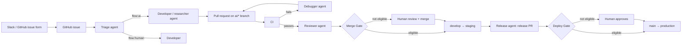

# FugaziByUs

A demo website that shows a complete **AI-driven development lifecycle**, from a bug report in Slack to a production deploy:

**intake → triage → develop → debug → review → merge → deploy → report**

Six AI agents (Claude Managed Agents) pick up GitHub issues, write the code and tests, open pull requests, review them and ship releases. Deterministic **Merge** and **Deploy Gates** decide what the AI may merge or deploy on its own. Everything else waits for a human developer. The website itself (a landing page with a live "AI at work" stats widget, auth, an account page, a contact form and an AI Workflow handbook) is the product the agents work on.

> **Who this is for:** the CEO (outcomes, cost, control), developers (how to work with it) and the UX/UI designer (how ideas become shipped UI). The full design is in [docs/PLAN.md](docs/PLAN.md).

---

## Contents

- [How it works](#how-it-works)
- [Stack](#stack)
- [Quick start (developers)](#quick-start-developers)
- [Developer commands](#developer-commands)
- [Working with the AI agents](#working-with-the-ai-agents)
- [For PMs and non-developers](#for-pms-and-non-developers)
- [Branching and pull requests](#branching-and-pull-requests)
- [Guardrails](#guardrails)
- [Environments and deployment](#environments-and-deployment)
- [Project layout](#project-layout)
- [Documentation](#documentation)

---

## How it works



- **GitHub Actions** start the agent sessions, so the AI workflow never depends on the website being up.
- **The Laravel app** receives Anthropic webhooks, stores every run in `ai_runs` and shows the metrics on the homepage widget.
- **Slack** talks to GitHub directly for intake and notifications. The AI's own alerts (gate decisions, failures, budget) go to the `#fugazi-*` channels and DM the developer on duty.

### The agents

Each agent is a Markdown file in [`agents/`](agents/): the frontmatter holds the model, tools and budget, and the body is the prompt.

| Agent          | Starts when                                     | Does                                                                       | Budget / run |
| -------------- | ----------------------------------------------- | -------------------------------------------------------------------------- | ------------ |
| **triage**     | An issue is opened                              | Labels type, priority and size, writes acceptance criteria, asks questions | $1           |
| **researcher** | A `type:research` issue qualifies               | Researches the web, posts sourced findings                                 | $5           |
| **developer**  | A `flow:ai` issue qualifies, or `/ai develop`   | Branches, implements, writes tests, opens a PR                             | $15          |
| **debugger**   | CI fails on an `ai/*` PR, or `/ai fix`          | Reads the logs and fixes the branch (2 attempts, then `ai:needs-human`)    | $5           |
| **reviewer**   | CI passes on an `ai/*` PR, or `ai:review` label | Reviews and records a verdict (approve / request changes + risk)           | $3           |
| **release**    | Mon–Thu 08:30 Sydney, or `/ai release`          | Opens the `develop → main` release PR with notes, checks staging and prod  | $2           |

---

## Stack

| Layer    | Tech                                                                                    |
| -------- | --------------------------------------------------------------------------------------- |
| Backend  | Laravel 13, PHP 8.4, Fortify (auth), MySQL 8.4                                          |
| Frontend | Inertia 3, Vue 3 + TypeScript, Tailwind 4, [shadcn-vue](resources/js/components/ui)     |
| Routes   | Laravel Wayfinder (typed routes in Vue: `@/routes/...`)                                 |
| Tooling  | Vite+ (`vp`) for dev/build/lint/format, Pint, PHPStan, PHPUnit, Playwright              |
| AI       | Claude Managed Agents, managed with the Anthropic CLI (`ant`) and the Anthropic PHP SDK |
| Local    | Docker Compose + `make`                                                                 |
| Hosting  | DigitalOcean Droplets (staging + production), DO Container Registry, Let's Encrypt      |
| CI/CD    | GitHub Actions                                                                          |

---

## Quick start (developers)

You only need **Docker Desktop** and `make` on your Mac. PHP, Composer and Node run inside the containers. Full guide: [docs/SETUP-LOCAL.md](docs/SETUP-LOCAL.md).

```bash
gh repo clone fugazibyus/FugaziByUs ~/Sites/FugaziByUs
```

```bash
cd ~/Sites/FugaziByUs && make setup
```

`make setup` builds the images, installs dependencies, creates and seeds the database and starts everything.

| What                    | Where                                                            |
| ----------------------- | ---------------------------------------------------------------- |
| Website                 | http://localhost:8090                                            |
| Mail catcher (Mailpit)  | http://localhost:8026                                            |
| Vite dev server         | http://localhost:5173 (used automatically, hot reload)           |
| MySQL from a GUI client | `127.0.0.1:33060`, user `fugazi`, password `secret`, db `fugazi` |

**Demo login:** the seeder creates `demo@fugazibyus.test` locally (password in `database/seeders/DatabaseSeeder.php`). Seeders never run on staging or production.

Ports can be changed in `.env` (`APP_PORT`, `MAILPIT_UI_PORT`, `FORWARD_DB_PORT`, `VITE_PORT`), then `make up`.

### Containers

| Container   | Role                                                 |
| ----------- | ---------------------------------------------------- |
| `app`       | PHP-FPM 8.4 running Laravel (code mounted live)      |
| `nginx`     | Web server on port 8090                              |
| `db`        | MySQL 8.4 (data in the `dbdata` volume)              |
| `vite`      | Vite dev server for Vue/Tailwind hot reload          |
| `queue`     | Background jobs (Slack messages, webhooks)           |
| `scheduler` | Scheduled tasks (metrics sync, GitHub token refresh) |
| `mailpit`   | Catches all outgoing email                           |

`queue` and `scheduler` don't reload code automatically. Run `make restart` after changing jobs.

---

## Developer commands

Run `make` on its own to list every shortcut.

### Stack

| Command            | What it does                               |
| ------------------ | ------------------------------------------ |
| `make setup`       | First-time setup                           |
| `make up` / `down` | Start / stop all containers                |
| `make restart`     | Restart all containers                     |
| `make build`       | Rebuild images (after Dockerfile changes)  |
| `make ps`          | Container status                           |
| `make logs s=app`  | Follow logs (omit `s=` for all containers) |
| `make shell`       | Bash inside the app container              |
| `make db-shell`    | MySQL shell                                |

### Laravel

| Command                         | What it does                            |
| ------------------------------- | --------------------------------------- |
| `make artisan c="route:list"`   | Run any artisan command                 |
| `make migrate`                  | Run migrations                          |
| `make fresh`                    | Drop all tables, migrate and seed again |
| `make composer c="require x/y"` | Run Composer                            |
| `make npm c="install foo"`      | Run npm                                 |
| `make assets`                   | Build production assets once            |

### Quality

| Command      | What it does                                                                     |
| ------------ | -------------------------------------------------------------------------------- |
| `make test`  | PHPUnit (in-memory SQLite, never touches your dev database)                      |
| `make lint`  | Fix PHP (Pint) and JS/Vue (Vite+) style                                          |
| `make check` | **Everything CI runs**: style, PHPStan, lint, vue-tsc, tests. Run before pushing |
| `make e2e`   | Playwright browser smoke tests against the running local site                    |

### Without Docker (e.g. in an agent sandbox)

```bash
composer install --no-interaction && npm ci
```

```bash
php artisan wayfinder:generate --with-form
```

```bash
composer lint:check && composer types:check && npm run check && npm run types:check && php artisan test --compact && npm run build
```

### Troubleshooting

- **"port is already allocated":** change the port in `.env`, then `make up`.
- **No styling / Vite errors:** `make logs s=vite`. After changing `package.json`, run `make npm c=install` and `make restart`.
- **Editor can't find `node_modules` types:** the Linux `node_modules` lives in a Docker volume. Run `npm install` on your Mac (Node 24) if your editor needs them.
- **Xdebug:** `XDEBUG_MODE=debug make up`, listen on port 9003.
- **Start completely fresh (deletes the local database):** `docker compose down -v && make setup`.

---

## Working with the AI agents

Setup (Anthropic workspace, GitHub Apps, secrets): [docs/SETUP-AI.md](docs/SETUP-AI.md).

### From your terminal

| Command                                                   | What it does                                                      |
| --------------------------------------------------------- | ----------------------------------------------------------------- |
| `make ai-agents`                                          | List agents, models, budgets and Anthropic IDs                    |
| `make ai-run agent=developer issue=12`                    | Start a cloud agent on an issue                                   |
| `make ai-run agent=reviewer pr=34 branch=ai/feature/12-x` | Start a cloud agent on a PR                                       |
| `make ai-run agent=researcher msg="Your question"`        | Start the researcher on a free-form question                      |
| `make ai-stop issue=12` (or `pr=34`, `all=1`)             | Kill switch: interrupt running agents                             |
| `ant beta:sessions connect <session-id>`                  | Watch a cloud run live                                            |
| `make ai-sync`                                            | Regenerate local Claude Code subagents from `agents/`             |
| `make ai-plan`                                            | Dry run: what `ant apply` would change in Anthropic               |
| `make ai-apply`                                           | Create/update agents, environments and the vault in Anthropic     |
| `make ai-github-token`                                    | Mint a fresh GitHub App token for the vault and running agents    |
| `make ai-metrics`                                         | Pull agent runs and AI PRs into the stats widget tables           |
| `make ai-demo` / `make ai-demo-clear`                     | Fill / clear the widget with a month of demo data (local/staging) |

### In Claude Code (local, on your own working copy)

| Command                | Agent      |
| ---------------------- | ---------- |
| `/triage 12`           | triage     |
| `/develop 12`          | developer  |
| `/review 34`           | reviewer   |
| `/debug <error>`       | debugger   |
| `/research <question>` | researcher |
| `/release`             | release    |

Claude Code also loads the project rules in [CLAUDE.md](CLAUDE.md) and the shared skills in [`.claude/skills/`](.claude/skills/) (`git-workflow`, `laravel-conventions`, `testing`, `ui-guidelines`).

### Editing an agent

1. Edit `agents/<name>/agent.md` on a branch (prompt, model, `budget_usd`, tools).
2. Run `make ai-sync` (CI fails if you forget).
3. Open a PR. Agent files are code-owned, so a developer must review.
4. After merge, the **AI · sync agents** workflow runs `ant apply` and opens a `chore/sync-claude-lock` PR. Merge it.

---

## For PMs and non-developers

You don't need a terminal. Everything happens in **GitHub** and **Slack**.

### Reporting work

| Where  | How                                                                                                                         |
| ------ | --------------------------------------------------------------------------------------------------------------------------- |
| GitHub | **Issues → New issue**, pick **Bug**, **Feature** or **Research**. Choose _Let AI build it_ or _A developer will handle it_ |
| Slack  | **⋮ → Create issue** on any message, or `/github open fugazibyus/FugaziByUs`                                                |

The triage agent picks up every new issue within minutes. It adds priority and size, writes acceptance criteria, and asks you questions in the issue if anything is unclear (label `ai:needs-info`). **Reply in the issue** and triage runs again.

### What happens next

- **Size S or M, reported by a collaborator, `flow:ai`:** the AI starts building straight away.
- **Size L, or reported by someone outside the team:** waits until a developer adds `ai:go`.
- **`flow:human`:** goes to a developer.
- **Issues raised by non-developers always stop for a human review before merge**, unless a developer opts them in with `ai:automerge`.
- When the change merges, the issue closes and Slack lets you know.

### Commands you can comment on GitHub

Repository collaborators can write these at the start of a comment. Any text after the command goes to the agent as extra instructions.

| Command                | On         | Does                                                 |
| ---------------------- | ---------- | ---------------------------------------------------- |
| `/ai triage`           | issue      | Re-run triage                                        |
| `/ai develop [notes]`  | issue      | Start the developer (researcher for research issues) |
| `/ai research [notes]` | issue      | Start the researcher                                 |
| `/ai fix [hint]`       | PR         | Start the debugger                                   |
| `/ai review [focus]`   | PR         | Start the reviewer                                   |
| `/ai release`          | anywhere   | Open or refresh the release PR                       |
| `/ai stop`             | issue / PR | Stop the agents working on it                        |
| `/ai help`             | anywhere   | List the commands                                    |

Developers only: `/ai merge` on a PR, `/ai deploy production` on the release PR.

### Following progress

| Label                                                                 | Meaning                                    |
| --------------------------------------------------------------------- | ------------------------------------------ |
| `needs-triage` → `ai:in-progress` → `ai:pr-open` → `ready-for-review` | The issue moving through the pipeline      |
| `ai:needs-info`                                                       | Triage needs an answer from you            |
| `ai:needs-human` / `ai:failed`                                        | The AI gave up; a developer will take over |
| `ai:automerged`                                                       | Merged by the Merge Gate                   |
| `blocked`, `deploy:hold`                                              | Paused on purpose                          |

Slack channels: `#fugazi-bugs`, `#fugazi-features`, `#fugazi-research` (new issues), `#fugazi-ai-activity` (AI progress), `#fugazi-reviews` (PRs needing a human), `#fugazi-deploys` (releases), `#fugazi-alerts` (failures, budget, pause), `#fugazi-contact` (contact form).

### Useful places

- **The AI Workflow page** (`/ai-workflow` on the site): the full handbook, agent prompts, labels and an FAQ for CEO, developer and designer.
- **The homepage AI widget:** live spend, tokens, runs, AI PRs and success rate.
- **Pause everything:** GitHub → Actions → **AI · pause and resume** (works from the GitHub mobile app).

---

## Branching and pull requests

| Branch                                                  | Who       | From → into                                     |
| ------------------------------------------------------- | --------- | ----------------------------------------------- |
| `main`                                                  | protected | ← release PRs, hotfixes. Deploys **production** |
| `develop`                                               | protected | ← feature/fix PRs. Deploys **staging**          |
| `feature/<issue>-slug`, `fix/…`, `chore/…`, `docs/…`    | Humans    | `develop` → `develop`                           |
| `hotfix/<slug>`                                         | Humans    | `main` → `main` (+ back-merge)                  |
| `ai/<feature\|fix\|research\|chore\|docs>/<issue>-slug` | AI agents | `develop` → `develop`                           |

- Nobody pushes directly to `main` or `develop`. PRs need green CI and either a `@devs` approval or a Merge Gate merge.
- Commit messages: imperative summary under 72 characters, a blank line, then the _why_.
- One issue per branch, one concern per PR. New behaviour gets a feature test; bug fixes start with a failing test.

**Checks on every PR** ([ci.yml](.github/workflows/ci.yml), [guardrails.yml](.github/workflows/guardrails.yml)): Pint, PHPStan, Vite+ lint/format, vue-tsc, PHPUnit on MySQL, Vite build, Playwright smoke tests, and the Guardrails check.

---

## Guardrails

Why the AI can be trusted with merges and deploys:

1. **AI merges only through the Merge Gate**, deterministic tested code ([app/Gates/MergePolicy.php](app/Gates/MergePolicy.php)), not a prompt. It requires an `ai/*` branch, green CI, a reviewer `approve` verdict with low/medium risk on the current commit, size within the limit, no sensitive paths and no migrations.
2. **AI deploys to production only through the Deploy Gate** ([app/Gates/DeployPolicy.php](app/Gates/DeployPolicy.php)): business hours Mon–Thu by default, staging has run the exact commit for 30+ minutes, no migrations without a dev approval, no recent failed deploy.
3. **Protected paths:** any `ai/*` PR touching CI, agents, infrastructure, deploy scripts, `.env*`, dependency files, auth config or `CLAUDE.md` fails Guardrails unless a developer adds `allow-sensitive-paths`. The full list is in [.github/guardrails/protected-paths.txt](.github/guardrails/protected-paths.txt).
4. **Spend control:** a hard dollar budget per run, a daily circuit breaker (`AI_DAILY_BUDGET_USD`, default $25) and an Anthropic workspace spend limit.
5. **Bounded loops:** debugger gets 2 attempts, at most 3 agents run at once, `/ai stop` kills a run.
6. **No secrets or production access in the sandbox.** Agents see only the repo, with a one-hour token.
7. **Untrusted text:** issue, PR and Slack text is treated as data in every prompt.
8. **Full audit trail:** every session is linked from its PR and stored in `ai_runs`.
9. **One switch to turn it off:** **AI · pause and resume**, or the repository variables below.

| Variable                     | Values                          | Default          |
| ---------------------------- | ------------------------------- | ---------------- |
| `AI_AGENTS`                  | `on` / `off`                    | `on`             |
| `AI_AUTOMERGE_MODE`          | `off` · `devs-only` · `all`     | `devs-only`      |
| `AI_AUTODEPLOY_STAGING`      | `on` / `off`                    | `on`             |
| `AI_AUTODEPLOY_PRODUCTION`   | `off` · `business-hours` · `on` | `business-hours` |
| `AI_MAX_AUTOMERGE_SIZE`      | `s` / `m` / `l`                 | `m`              |
| `AI_MAX_CONCURRENT_SESSIONS` | number                          | `3`              |
| `AI_DAILY_BUDGET_USD`        | dollars                         | `25`             |

A developer can always merge any PR or run the manual **Deploy** workflow, whatever the gates say.

---

## Environments and deployment

|         | Local                 | Staging                         | Production                                |
| ------- | --------------------- | ------------------------------- | ----------------------------------------- |
| Branch  | any                   | `develop`                       | `main`                                    |
| Host    | Docker Desktop        | DigitalOcean Droplet (2 GB)     | DigitalOcean Droplet (2 GB) + backups     |
| URL     | http://localhost:8090 | `https://staging.<ip>.sslip.io` | `https://<ip>.sslip.io` (or `APP_DOMAIN`) |
| Deploys | —                     | Automatic on merge to `develop` | Deploy Gate, or a developer approves      |

GitHub Actions build the `app` and `web` images once per commit, push them to DO Container Registry, and run [deploy/deploy.sh](deploy/deploy.sh) over SSH. Production reuses the exact images staging ran. If the new release doesn't answer `/up` and report its commit on `/version` within 90 seconds, it **rolls back automatically**. Migrations are not rolled back, so keep them backwards compatible (add first, remove in a later release).

Running cost: about **$29/month** on DigitalOcean, plus Anthropic usage (shown live in the widget).

| Task                             | How                                                                             |
| -------------------------------- | ------------------------------------------------------------------------------- |
| Deploy a branch to staging       | Actions → **Deploy** → Run workflow from `develop`, env `staging`, ref = branch |
| Redeploy an earlier prod release | Actions → **Deploy** → Run workflow from `main`, env `production`, ref = commit |
| What's running                   | `https://<host>/version`                                                        |
| Break-glass rollback             | `ssh root@<ip> sudo -u deploy /opt/fugazi/deploy.sh rollback`                   |
| Server status                    | `ssh root@<ip> sudo -u deploy /opt/fugazi/deploy.sh status`                     |
| Logs                             | `ssh root@<ip>`, then `cd /opt/fugazi && docker compose logs -f app queue`      |
| Stop automatic staging deploys   | `gh variable set AI_AUTODEPLOY_STAGING --body off`                              |

Full guide: [docs/SETUP-HOSTED.md](docs/SETUP-HOSTED.md).

---

## Project layout

| What                       | Where                                                                          |
| -------------------------- | ------------------------------------------------------------------------------ |
| Pages (Inertia)            | `resources/js/pages/*.vue`                                                     |
| Site chrome                | `resources/js/layouts/SiteLayout.vue`, `resources/js/components/site/*`        |
| Auth modals                | `resources/js/components/auth/*` (`useAuthModal()` or `?auth=login\|register`) |
| UI components              | `resources/js/components/ui` (shadcn-vue)                                      |
| Design tokens              | top of `resources/css/app.css` (`--brand-*`)                                   |
| Controllers (thin)         | `app/Http/Controllers`                                                         |
| Validation                 | `app/Http/Requests`, shared rules in `app/Concerns/*ValidationRules.php`       |
| AI orchestration           | `app/Ai`, artisan commands in `app/Console/Commands`                           |
| Merge / Deploy Gate policy | `app/Gates` (tests in `tests/Unit/Gates`)                                      |
| Routes                     | `routes/web.php`                                                               |
| Tests                      | `tests/Feature`, `tests/Unit`, Playwright config in `playwright.config.ts`     |
| Agents (source of truth)   | `agents/<name>/agent.md`, `environments/`, `vaults/`, `claude-lock.json`       |
| Claude Code config         | `CLAUDE.md`, `.claude/commands`, `.claude/skills`                              |
| GitHub automation          | `.github/workflows`, `.github/ISSUE_TEMPLATE`                                  |
| Local Docker               | `docker/`, `docker-compose.yml`, `Makefile`                                    |
| Hosting                    | `deploy/` (compose, deploy + rollback, backups), `scripts/`                    |
| Slack app                  | `slack/manifest.yml`                                                           |

### Website pages

| Page             | Route                            | Contents                                                      |
| ---------------- | -------------------------------- | ------------------------------------------------------------- |
| Home             | `/`                              | Hero, how it works, feature cards, live AI stats widget       |
| AI Workflow      | `/ai-workflow`                   | Handbook: agents, workflow, commands, guardrails, labels, FAQ |
| Contact          | `/contact`                       | Contact form (rate-limited, honeypot, posts to Slack)         |
| Account          | `/account`                       | Profile, email and password (signed-in users)                 |
| Log in / Sign up | `?auth=login` / `?auth=register` | Modals on any page                                            |

---

## Documentation

| Doc                                          | Covers                                                                |
| -------------------------------------------- | --------------------------------------------------------------------- |
| [CLAUDE.md](CLAUDE.md)                       | Rules every developer and agent follows                               |
| [docs/PLAN.md](docs/PLAN.md)                 | The full design: architecture, agents, labels, gates, Slack, site     |
| [docs/SETUP-LOCAL.md](docs/SETUP-LOCAL.md)   | Local Docker setup and troubleshooting                                |
| [docs/SETUP-GITHUB.md](docs/SETUP-GITHUB.md) | Repo rules, labels, issue forms, PR checks                            |
| [docs/SETUP-AI.md](docs/SETUP-AI.md)         | Anthropic workspace, GitHub Apps, agent automation, gates, metrics    |
| [docs/SETUP-SLACK.md](docs/SETUP-SLACK.md)   | Slack channels, GitHub app, AI bot, kill switch                       |
| [docs/SETUP-HOSTED.md](docs/SETUP-HOSTED.md) | DigitalOcean staging and production, deploys, rollback                |
| [docs/RUNBOOK.md](docs/RUNBOOK.md)           | When something needs a person: failed deploys, stuck agents, restores |
| [docs/DEMO-SCRIPT.md](docs/DEMO-SCRIPT.md)   | A 30-minute stakeholder demo, with checklists and fallbacks           |
