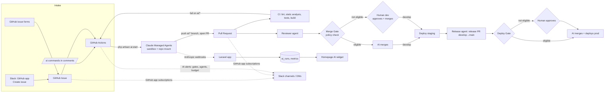

# FugaziByUs — Project Plan

> A demo site that shows one complete AI-driven development lifecycle: intake → triage → develop → debug → review → PR → human merge → deploy → report.
> Audience: CEO (outcomes, cost, control), developers (how to work with it), UX/UI designer (how ideas become shipped UI).

**Decisions locked in**

| Topic             | Decision                                                                                                                                                                                                                                                   |
| ----------------- | ---------------------------------------------------------------------------------------------------------------------------------------------------------------------------------------------------------------------------------------------------------- |
| Stack             | Laravel (latest stable) + Inertia + Vue 3 (TypeScript) + Tailwind 4, MySQL 8.4, Nginx, PHP-FPM 8.4                                                                                                                                                         |
| Containers        | `app` (php-fpm), `db` (mysql), `nginx` + support containers from the same images: `queue`, `scheduler`, `vite` (local only), `mailpit` (local only), `certbot` (hosted only)                                                                               |
| Orchestrator      | **Hybrid**: GitHub Actions start agent sessions; the Laravel app receives Slack + Anthropic webhooks, stores metrics, sends Slack alerts                                                                                                                   |
| Hosting           | DigitalOcean: **staging Droplet** (`develop`) + **production Droplet** (`main`), images in DO Container Registry                                                                                                                                           |
| Agents            | Claude Managed Agents, defined as files in the repo and synced with `ant apply`; the same prompt files generate local Claude Code subagents                                                                                                                |
| Domain            | Day one: free `sslip.io` hostname per Droplet (real HTTPS, works immediately). Later: real domain by changing one secret                                                                                                                                   |
| AI merge & deploy | **AI can merge and deploy**, through a deterministic **Merge Gate** and **Deploy Gate** (see §6a). Issues reported by non-developers still stop before merge unless a developer opts them in. Switches let you turn this down to "humans only" at any time |

**About the domain question:** Droplets don't get a hostname — only an IP (App Platform gives `*.ondigitalocean.app`, but it doesn't fit the separate-containers requirement). `sslip.io` turns any IP into a hostname, e.g. `staging.164-90-12-34.sslip.io` resolves to `164.90.12.34`. Let's Encrypt issues real certificates for it, so HTTPS, Slack webhooks and Anthropic webhooks all work straight away. When you buy a domain, change `APP_DOMAIN` in the GitHub environment and redeploy.

---

## 1. Architecture



**Why hybrid:** the AI workflow never depends on the website being up. Actions start the sessions, and Slack talks to GitHub directly. The Laravel app adds what only it can: the metrics widget (fed by Anthropic webhooks) and the site itself.

**One implementation of "start an agent":** an Artisan command, `php artisan ai:start {agent} --issue= --pr= --branch=`, built on the official Anthropic PHP SDK. It is used by GitHub Actions, by you locally (`make ai-run`), and by the Slack handler. No duplicated logic.

---

## 2. Repository layout

```
FugaziByUs/
├── app/                      # Laravel app (+ app/Ai/* orchestration, app/Slack/*)
├── resources/js/             # Inertia + Vue 3 pages/components
├── agents/                   # ★ SOURCE OF TRUTH for every agent (editable prompts)
│   ├── triage/agent.md       #   frontmatter = model/tools/budget, body = system prompt
│   ├── researcher/agent.md
│   ├── developer/agent.md
│   ├── debugger/agent.md
│   ├── reviewer/agent.md
│   └── release/agent.md
├── environments/sandbox.yaml # Managed Agents sandbox: php, composer, node, sqlite; limited egress
├── vaults/github.yaml        # vault container (credentials added via CLI, never in git)
├── claude-lock.json          # written by `ant apply` – committed
├── .claude/
│   ├── agents/               # GENERATED from /agents for local Claude Code (make ai-sync)
│   ├── commands/             # local slash commands: /triage /develop /review /debug /research /release
│   ├── skills/               # shared skills: laravel-conventions, testing, branching, ui-guidelines
│   │                         #   (auto-loaded by Managed Agents when the repo is mounted AND by Claude Code)
│   └── settings.json         # local guardrails (deny edits to .env, workflows, etc.)
├── CLAUDE.md                 # project rules every agent + human-with-Claude follows
├── docker/                   # php/, nginx/, mysql/ Dockerfiles + configs
├── docker-compose.yml        # local
├── docker-compose.prod.yml   # staging/prod
├── Makefile                  # make up / test / ai-sync / ai-run / deploy-*
├── slack/manifest.yml        # one-click Slack app definition
├── scripts/                  # bootstrap-labels.sh, bootstrap-github.sh, droplet-init.sh
├── .github/
│   ├── workflows/            # ci, ai-*, agents-sync, deploy-*, guardrails
│   ├── ISSUE_TEMPLATE/       # bug.yml, feature.yml, research.yml (non-dev friendly)
│   ├── CODEOWNERS
│   └── pull_request_template.md
└── docs/                     # PLAN.md, SETUP-LOCAL.md, SETUP-HOSTED.md, RUNBOOK.md, DEMO-SCRIPT.md
```

**Editing a prompt:** edit `agents/<name>/agent.md` on a branch and open a PR. CI shows the `ant apply --dry-run` plan as a PR comment. When the PR merges to `main`, `ant apply --yes` creates a new agent version. Sessions already running keep their old version, and you can roll back by reverting the commit. `make ai-sync` regenerates the local Claude Code copies, so local and cloud prompts never drift. The AI Workflow page on the site renders these files live.

---

## 3. The agents

All agents default to `claude-opus-5-5`. The model is one line in each file's frontmatter, so you can move cheaper agents (triage) to Sonnet or Haiku whenever you like. Each session gets a **hard dollar budget** (Managed Agents session budgets).

| Agent          | Trigger                                                              | Does                                                                                                                                                                                                                         | Can't                                                                             | Budget |
| -------------- | -------------------------------------------------------------------- | ---------------------------------------------------------------------------------------------------------------------------------------------------------------------------------------------------------------------------- | --------------------------------------------------------------------------------- | ------ |
| **triage**     | Issue opened, Slack intake, `/ai triage`                             | Classifies type/priority/size, asks clarifying questions, writes acceptance criteria, routes `flow:ai` vs `flow:human`                                                                                                       | Touch code; only labels + comments                                                | $1     |
| **researcher** | `type:research` + `flow:ai` (including issues created from Slack)    | Web research, writes findings to the issue + a `docs/research/*.md` PR                                                                                                                                                       | Change app code                                                                   | $5     |
| **developer**  | `flow:ai` issue approved (see §5) or `/ai develop`                   | Branches `ai/<type>/<issue>-slug` from `develop`, implements, writes PHPUnit tests, runs tests/lint in sandbox, opens PR                                                                                                     | Push to `main`/`develop`, edit workflows/agents/infra, merge                      | $15    |
| **debugger**   | CI fails on an `ai/*` branch, `/ai fix`, bug issues                  | Reads CI logs, reproduces, fixes, pushes to same branch (max 2 attempts, then `ai:needs-human`)                                                                                                                              | Same as developer                                                                 | $5     |
| **reviewer**   | Every PR from `ai/*`; human PRs on `/ai review` or `ai:review` label | Reviews correctness, security, tests, conventions, UI consistency; posts a GitHub review with inline comments and a structured **verdict** (`approve` / `request-changes`, risk `low/medium/high`) that the Merge Gate reads | Merge directly (only the Merge Gate merges)                                       | $3     |
| **release**    | Daily schedule, `/ai release`                                        | Opens the release PR `develop→main` with release notes, runs smoke checks against staging, decides "ready to ship" and asks the Deploy Gate to ship it; after the deploy, checks prod and summarises it on the release PR    | Run deploy scripts itself (the Deploy Gate workflow does the deploy and rollback) | $2     |

**Commands that drive the agents**

| Where                                | Commands                                                                                                                                                                                                                                         |
| ------------------------------------ | ------------------------------------------------------------------------------------------------------------------------------------------------------------------------------------------------------------------------------------------------ |
| GitHub comments (collaborators only) | `/ai triage`, `/ai develop`, `/ai fix`, `/ai review`, `/ai research`, `/ai stop`, `/ai merge` (devs: ask the Merge Gate to merge now; `@product`: ship an approved AI PR to staging), `/ai release`, `/ai deploy staging\|production` (dev-only) |
| Slack                                | **⋮ → Create issue** on any message, or `/github open fugazibyus/FugaziByUs` (GitHub's app for Slack). Alerts arrive in the `#fugazi-*` channels                                                                                                 |
| Local Claude Code                    | `/triage 12`, `/develop 12`, `/review 34`, `/debug`, `/research "topic"`, `/release` (same prompts, run on your own working copy)                                                                                                                |
| Local terminal → cloud               | `make ai-run agent=developer issue=12` (starts the same Managed Agent remotely), `ant beta:sessions connect` to watch live                                                                                                                       |
| Manual deploy                        | Actions → "Deploy" → choose env + ref, or `make deploy env=staging` (break-glass over SSH)                                                                                                                                                       |

---

## 4. Branching model (human + AI by naming)

| Branch                                                               | Who       | From → into                                | Automation                                                                                          |
| -------------------------------------------------------------------- | --------- | ------------------------------------------ | --------------------------------------------------------------------------------------------------- |
| `main`                                                               | protected | ← release PRs from `develop`, ← `hotfix/*` | Merge → deploy **prod** through the Deploy Gate (automatic when eligible, otherwise a dev approves) |
| `develop`                                                            | protected | ← feature/fix PRs                          | Merge → deploy **staging**                                                                          |
| `feature/<issue>-slug`, `fix/…`, `chore/…`, `docs/…`                 | Humans    | `develop` → `develop`                      | CI. AI review only on request                                                                       |
| `hotfix/<slug>`                                                      | Humans    | `main` → `main` (+ back-merge)             | CI + AI review                                                                                      |
| `ai/feature/<issue>-slug`, `ai/fix/…`, `ai/research/…`, `ai/chore/…` | AI agents | `develop` → `develop`                      | CI + auto AI review + auto debugger on failure                                                      |

Rules enforced by GitHub rulesets: nobody pushes directly to `main`/`develop`. PRs need green CI and either 1 approval from `@devs` (CODEOWNERS) **or** a merge by the **Fugazi Merge Gate** GitHub App, which is the only actor on the ruleset's bypass list. The coding agents' own GitHub App (**Fugazi AI**, `fugazi-ai[bot]`) can push `ai/*` branches but **can't merge anything itself**. Only the gate merges, and only after its policy checks pass (§6a). A human developer can take over any `ai/*` branch by pushing to it. The `ai:needs-human` label hands it back.

---

## 5. Issue lifecycle & labels

1. **Report.** A non-developer uses a GitHub issue form (Bug / Feature / Research) or Slack. The form includes "How should this be handled? → _Let AI build it_ / _A developer will handle it_". Labels added: `needs-triage`, `type:*`, `source:github|slack`, and `flow:ai|flow:human`.
2. **Triage agent** runs automatically on every new issue (cheap and fast). It adds `priority:*` and `size:s|m|l`, writes acceptance criteria, and asks questions if the issue is unclear (`ai:needs-info`).
3. **Route.**
    - `flow:human`: stops here. Goes to the board for a developer.
    - `flow:ai` + size S/M + reporter is a repo collaborator: the developer/researcher agent starts automatically.
    - `flow:ai` + size L, or an outside reporter: waits until a developer adds `ai:go`.
4. **Develop → PR → CI → (debugger) → reviewer.** Status labels move along: `ai:in-progress` → `ai:pr-open` → `ready-for-review`.
5. **Merge.** The Merge Gate checks the PR (§6a).
    - **Eligible:** the gate merges it into `develop` (`ai:automerged`) and staging deploys.
    - **Not eligible:** the PR is labelled `ready-for-review` and a dev is DM'd to review and merge. **Issues reported by non-developers always land here** unless a dev or `@product` member adds `ai:automerge` or comments `/ai merge`.
    - Either way the issue auto-closes on merge, and Slack DMs the reporter.
6. **Ship.** The release agent bundles what's on `develop` into a release PR. The Deploy Gate decides whether the AI can merge it and deploy production, or whether a dev must approve.

**Labels** (created by `scripts/bootstrap-labels.sh`):

- Type: `type:bug`, `type:feature`, `type:research`, `type:chore`
- Flow: `flow:ai`, `flow:human`
- Control: `ai:go`, `ai:stop`, `ai:review`, `ai:automerge` (dev or `@product` opts a PR/issue into AI merge), `ai:no-automerge` (dev forces human merge), `deploy:hold` (blocks AI prod deploy), `allow-sensitive-paths`
- Status: `needs-triage`, `ai:needs-info`, `ai:in-progress`, `ai:pr-open`, `ai:needs-human`, `ai:failed`, `ready-for-review`, `ai:automerged`, `blocked`
- Meta: `priority:low|medium|high`, `size:s|m|l`, `source:github|slack`

---

## 6. Guardrails (the "why the CEO can trust this" list)

1. **AI merges only through the Merge Gate.** The gate is deterministic code in GitHub Actions, not a prompt. The model's review is one input, and the policy decides. Everything else needs a human approval, enforced by GitHub rulesets and CODEOWNERS.
2. **AI deploys to production only through the Deploy Gate.** It has the same checks plus live staging health, and auto-rollback stays on.
3. **Protected paths.** The `guardrails.yml` check fails any `ai/*` PR that touches `.github/`, `agents/`, `environments/`, `docker/`, `.env*` or `composer.json` deps without a dev-applied `allow-sensitive-paths` label. CODEOWNERS also requires a dev review on these paths.
4. **Spend control.** Each agent has a hard per-session dollar budget, a daily circuit breaker (`AI_DAILY_BUDGET_USD`, so Actions refuse to start sessions once today's spend crosses it), and an Anthropic Console workspace spend limit.
5. **Bounded loops.** The debugger gets 2 attempts at most, at most 3 concurrent sessions, and an `ai:stop` kill switch.
6. **Secrets never enter the sandbox.** The GitHub token is injected by Anthropic's git proxy; MCP and API credentials live in a vault and are substituted at egress. The sandbox has limited network egress (GitHub, Packagist, npm only).
7. **No production access for agents.** Agents see only the repo. Tests run on SQLite in the sandbox and on MySQL in CI.
8. **Prompt-injection hygiene.** Issue, Slack and PR text is treated as untrusted data in every prompt. Triage has no code-write tools.
9. **Full audit trail.** Every session is linked in the PR body and stored in `ai_runs` (agent, version, issue/PR, tokens, cost, duration, outcome). PRs and comments come from the `fugazi-ai[bot]` identity.
10. **Prompts are code.** Prompt changes go through a PR, review, versioning and rollback.
11. **One-switch kill.** the **AI · pause and resume** workflow or repo variable `AI_AUTOMERGE_MODE=off` returns the whole system to "humans merge and approve deploys". In-flight work stops at the PR.

### 6a. Merge Gate & Deploy Gate (how AI merges and deploys safely)

Both gates are GitHub Actions workflows that hold a **GitHub App** token (`Fugazi Merge Gate`), the only identity on the ruleset bypass list. Agents never get that token. They can only ask the gate, and the gate re-checks every rule each time. Every decision (merged / refused + reasons) is posted on the PR, sent to Slack and stored in `ai_runs`.

**Policy switches** (repo variables, editable in GitHub or with the **AI · pause and resume** workflow):

| Variable                   | Values                                                                                          | Default          |
| -------------------------- | ----------------------------------------------------------------------------------------------- | ---------------- |
| `AI_AUTOMERGE_MODE`        | `off` · `devs-only` (issue raised or approved by a `@devs` member) · `all` (non-dev issues too) | `devs-only`      |
| `AI_AUTODEPLOY_STAGING`    | `on` / `off`                                                                                    | `on`             |
| `AI_AUTODEPLOY_PRODUCTION` | `off` · `business-hours` (Mon–Thu 09:00–16:00, your timezone) · `on`                            | `business-hours` |
| `AI_MAX_AUTOMERGE_SIZE`    | `s` / `m` / `l`                                                                                 | `m`              |

**Merge Gate: a PR into `develop` auto-merges only if ALL of the following hold:**

1. The mode allows it. Under `devs-only`, the issue was opened by a `@devs` member, or a `@devs` or `@product` member added `ai:automerge` or commented `/ai merge`. Other issues (designers, outside reporters) need that explicit opt-in; `ai:go` only starts the agent and never approves a merge.
2. The branch is `ai/*`. Human branches merge only by a human, or when a dev comments `/ai merge`.
3. All CI checks are green (lint, static analysis, types, tests, build, Playwright smoke, guardrails).
4. The reviewer agent's latest verdict is `approve`, risk `low` or `medium`, with no unresolved blocking comments, and it reviewed the current head commit.
5. Size is ≤ `AI_MAX_AUTOMERGE_SIZE`. No `ai:no-automerge`, `blocked` or `deploy:hold` labels.
6. No sensitive paths are touched (`.github/`, `agents/`, `environments/`, `docker/`, `.env*`, dependency files). **Database migrations never auto-merge in the first version.**
7. The branch is up to date with `develop`. The gate updates it and waits for CI again if needed.

The gate squash-merges with a message linking the issue, the agent sessions and the review, then deletes the branch.

**Deploy Gate:**

- **Staging:** deploys automatically after every merge into `develop`.
- **Production:** the release agent opens the release PR `develop→main` and requests the gate. The gate merges and deploys only if ALL of the following hold:
    1. `AI_AUTODEPLOY_PRODUCTION` allows it right now (business hours by default, never Fridays or weekends).
    2. Staging has been running this exact commit for ≥ 30 minutes, with smoke tests and health checks passing.
    3. Every PR in the release either auto-merged through the Merge Gate or was human-approved, and none carries `deploy:hold`.
    4. No migrations in the release, unless a dev approved the release PR.
    5. No production deploy in the last 60 minutes, and no failed prod deploy that hasn't been resolved.
- **If any check fails,** the `production` environment falls back to needing a dev's approval, and that dev gets a DM with the reasons.
- **After deploy:** health check → automatic rollback on failure → the release agent verifies prod and posts the summary.

**Manual override is always available:** a dev can merge any PR or run the manual `Deploy` workflow regardless of the gates.

---

## 7. Slack integration

Slack and GitHub talk to each other directly; the website isn't in the middle (setup: `docs/SETUP-SLACK.md`).

- **Intake (Slack → GitHub):** GitHub's official app for Slack. **⋮ → Create issue** on any message, or `/github open`. The issue's author is the reporter's own GitHub account. Form-less issues are labelled `flow:ai`, `needs-triage`, `source:slack` by the Issue intake workflow, and triage takes over.
- **GitHub's notifications (GitHub → Slack):** channel subscriptions in the same app, filtered by label and threaded per issue/PR.
- **The AI's own alerts (GitHub → Slack):** GitHub Actions post with the **Fugazi AI** bot token (`.github/scripts/slack-alert.sh`), and DM the on-duty developer (`SLACK_ON_DUTY`) when a person is needed.

| Event                                                   | Channel / person                                         | Sent by                            |
| ------------------------------------------------------- | -------------------------------------------------------- | ---------------------------------- |
| New bug / feature / research                            | `#fugazi-bugs` / `#fugazi-features` / `#fugazi-research` | GitHub app                         |
| Issue and PR progress, comments, reviews (AI work)      | `#fugazi-ai-activity` (threaded)                         | GitHub app                         |
| Agent started                                           | `#fugazi-ai-activity`                                    | `ai-agent.yml`                     |
| Agent couldn't start (budget, error)                    | `#fugazi-alerts` + DM on duty                            | `ai-agent.yml`                     |
| Merge Gate merged / needs a human review (failed rules) | `#fugazi-ai-activity` / `#fugazi-reviews` + DM on duty   | `merge-gate.yml`                   |
| Deploy Gate shipping / needs a developer                | `#fugazi-deploys` (+ DM on duty)                         | `deploy-gate.yml`                  |
| Debugger gave up, `ai:needs-human`                      | `#fugazi-alerts` + DM on duty                            | `ai-pull-requests.yml`, GitHub app |
| Releases and deployments                                | `#fugazi-deploys`                                        | GitHub app                         |
| AI paused / resumed                                     | `#fugazi-alerts`                                         | `ai-switches.yml`                  |
| Contact form submission                                 | `#fugazi-contact`                                        | the website                        |

- **Kill switch:** Actions → **AI · pause and resume** (works from the GitHub mobile app).
- **Developer actions** (release, merge, deploy) stay in GitHub: `/ai release`, `/ai merge`, `/ai deploy production` comments, or the Actions tab.

----------------------------------------------------------------- | -------------------------------------------------------- |
| New bug / feature / research | `#fugazi-bugs` / `#fugazi-features` / `#fugazi-research` |
| Agent run started/finished (+cost) | `#fugazi-ai-activity` (threaded per issue) |
| PR ready for review (gate said "human needed", with reasons) | `#fugazi-reviews` + DM to the CODEOWNER on duty |
| AI auto-merged a PR | `#fugazi-ai-activity` + DM to the issue reporter |
| Release ready / AI deploying to prod / prod deploy needs approval | `#fugazi-deploys` (+ DM to devs when approval is needed) |
| `ai:needs-human`, `ai:failed`, budget hit | `#fugazi-alerts` + DM to the issue's dev |
| Deploy started/succeeded/failed | `#fugazi-deploys` (failures also go to `#fugazi-alerts`) |
| Your issue shipped | DM to the reporter |
| Contact form submission | `#fugazi-contact` |

- GitHub username ↔ Slack user ID mapping lives in a `team_members` table, seeded from `config/team.php`.

---

## 8. The website

**Design:** clean and airy, Inter font, neutral slate palette with one violet accent, rounded-2xl cards, subtle gradients on the hero, light and dark mode. Design tokens live in Tailwind 4 `@theme` so the designer can see and change them in one place. Components use shadcn-vue (it ships with the Laravel Vue starter kit).

**Top menu:** Logo · Home · AI Workflow · Contact · (guest: Log in / Sign up buttons → modals) · (auth: avatar dropdown → My account, Log out).

| Page                           | Contents                                                                                                                                                                                                                                                                                  |
| ------------------------------ | ----------------------------------------------------------------------------------------------------------------------------------------------------------------------------------------------------------------------------------------------------------------------------------------- |
| **Landing `/`**                | Hero, "how it works" in 4 steps, feature cards, **live AI stats widget**, CTA to the AI Workflow page                                                                                                                                                                                     |
| **AI stats widget**            | Total spend ($), tokens (in/out/cached), agent runs (by agent, sparkline), AI PRs opened/merged, avg issue→PR time, success rate, last 5 runs. Fed by `/api/ai-stats` (cached 60s). A `php artisan ai:seed-demo` command provides realistic data for presentations before real runs exist |
| **Register modal**             | Email + password + confirm. Laravel `Password::defaults()` (min 12, mixed case, numbers, symbols, not in breach list), unique email, rate-limited, toast on success, auto-login                                                                                                           |
| **Login modal**                | Email + password, remember me, throttled, toast on error. Modals open via `?auth=login                                                                                                                                                                                                    | register`, so links are shareable |
| **Account `/account`**         | Profile (first name, last name), change email (requires current password), change password (current + new + confirm), log out. Every action gives a toast                                                                                                                                 |
| **Contact `/contact`**         | Name, email, subject, message, honeypot + rate limit → `contact_messages` table, success toast, Slack notification                                                                                                                                                                        |
| **AI Workflow `/ai-workflow`** | Tabbed handbook: Overview (CEO view) · Agents (rendered live from `agents/*.md`, including prompts) · Workflow diagram · Commands · Stack · Guardrails · Developer guide · Branching · Git cheatsheet · Labels · FAQ by role (CEO / Developer / Designer)                                 |

**Toasts:** server flash messages and validation errors are shared through Inertia and shown by a single toast component (success / info / error).

**Data model:** `users` (+ `first_name`, `last_name`), `contact_messages`, `ai_runs`, `ai_pull_requests`, `team_members`.

**Quality gates (CI):** Pint, PHPStan/Larastan, Vite+ lint and format (`vp check`), vue-tsc, PHPUnit (unit + feature), Vite build, and a Playwright smoke test of the key flows. All run on every PR.

---

## 9. Environments & deployment

|        | Local                        | Staging                                | Production                                                      |
| ------ | ---------------------------- | -------------------------------------- | --------------------------------------------------------------- |
| Host   | Docker Desktop (Mac)         | Droplet 2 GB (~$12/mo)                 | Droplet 2 GB (~$12/mo)                                          |
| URL    | `http://localhost:8090`      | `https://staging.<ip>.sslip.io`        | `https://<ip>.sslip.io` → real domain later                     |
| DB     | MySQL container (port 33060) | MySQL container + volume, nightly dump | Same + DO weekly backups                                        |
| Deploy | —                            | Auto on merge to `develop`             | Deploy Gate: AI-shipped when eligible, otherwise a dev approves |

**Pipeline** (`.github/workflows/deploy.yml`, built in phase 8): Actions build the `app` (php-fpm) and `web` (nginx + TLS) images from one Dockerfile and push them to DOCR tagged with the commit SHA. Production reuses the images of the develop commit staging ran, so it ships exactly what soaked. Over SSH, `deploy/deploy.sh` pulls with a 15-minute read-only registry login, runs `php artisan migrate --force`, starts the stack and checks that `/up` answers and `/version` reports the new commit. **If not, it rolls back** to the previous images and settings, which stay on the server. Slack is told either way. Let's Encrypt certificates are issued on the first deploy and renewed by a certbot container.

**Manual deploy:** Actions → Deploy → Run workflow (staging: any branch/tag/SHA from `develop`; production: any commit already on `main`). Break-glass without GitHub: `deploy.sh rollback` on the Droplet. Setup: `docs/SETUP-HOSTED.md`.

Rough running cost: about $29/month in DigitalOcean (2 Droplets + registry). Anthropic usage depends on volume and shows live in the widget. Typical sessions cost from tens of cents (triage) to a few dollars (feature development), always capped by the budgets above.

---

## 10. Build phases

| #   | Phase                                                                                                                                                                                                                      | Who                                | Output                                                    |
| --- | -------------------------------------------------------------------------------------------------------------------------------------------------------------------------------------------------------------------------- | ---------------------------------- | --------------------------------------------------------- |
| 0   | **Accounts & keys** (checklist in §11)                                                                                                                                                                                     | You (I give exact steps)           | Anthropic, GitHub org/bot, DO, Slack ready                |
| 1   | Scaffold Laravel + Inertia/Vue + Docker local env + Makefile                                                                                                                                                               | Me                                 | `make up` → site on localhost:8090                        |
| 2   | Site: layout/menu, toasts, auth modals, account, contact, landing                                                                                                                                                          | Me                                 | Working site + PHPUnit tests                              |
| 3   | GitHub: repo push, rulesets, CODEOWNERS, labels, issue forms, PR template, CI, guardrails                                                                                                                                  | Me (via `gh`) + you (org settings) | Protected repo with green CI                              |
| 4   | Agents: `agents/*`, environment, vault, `ant apply`, `ai:start` command, local Claude Code sync + slash commands, CLAUDE.md, skills                                                                                        | Me                                 | Agents live in your Anthropic workspace; runnable locally |
| 5   | AI workflows in Actions: triage, develop, debug, review, research, release, `/ai` comment commands, circuit breaker                                                                                                        | Me                                 | End-to-end issue → PR                                     |
| 5b  | Merge Gate + Deploy Gate workflows, policy variables, GitHub App setup, gate decision log                                                                                                                                  | Me + you (create GitHub App)       | AI merges to `develop` and ships to prod under policy     |
| 6   | Metrics: Anthropic webhook endpoint, `ai_runs`, sync job, stats API + widget, demo seeder                                                                                                                                  | Me                                 | Live widget                                               |
| 7   | Slack: manifest, inbound commands, outbound router, DMs                                                                                                                                                                    | Me + you (install app)             | Slack intake + alerts                                     |
| 8   | DigitalOcean: Droplet bootstrap script, prod compose, TLS, deploy + manual deploy + rollback                                                                                                                               | Me + you (create Droplets)         | Staging + prod live                                       |
| 9   | AI Workflow page content, docs (`SETUP-LOCAL`, `SETUP-HOSTED`, `RUNBOOK`, `DEMO-SCRIPT`)                                                                                                                                   | Me                                 | Stakeholder-ready demo                                    |
| 10  | Dress rehearsal: run the demo script end to end. Slack "add a dark-mode toggle" → triage → PR → review → **AI merge** → staging → **AI prod deploy**. Then show the same from a non-dev reporter stopping for human review | Both                               | Confidence for the presentation                           |

---

## 11. Setup checklist (detailed step-by-step goes in `docs/SETUP-*.md`)

**Your Mac:** Docker Desktop, Homebrew, `gh` (GitHub CLI), `ant` (Anthropic CLI: `brew install anthropics/tap/ant`), Claude Code. Optional: Node LTS for running Vite outside Docker.

**Anthropic Console**

1. Create a workspace `fugazibyus` and set a monthly spend limit.
2. Create an API key for CI → GitHub secret `ANTHROPIC_API_KEY`. (Upgrade path: Workload Identity Federation with GitHub OIDC, so there's no static key.)
3. Locally: run `ant auth login` (no key on disk).
4. Create a webhook endpoint `https://<prod-host>/webhooks/anthropic` subscribed to `session.status_*` → secret `ANTHROPIC_WEBHOOK_SIGNING_KEY`.

**GitHub**

1. Create a free org `fugazibyus`, a team `devs` (you), and repo `fugazibyus/FugaziByUs`.
2. Create a GitHub App **Fugazi AI** (contents, pull requests, issues: read/write; actions, checks, statuses: read; no workflows) and install it on the repo. It isn't in `devs` and isn't on the bypass list. Each agent run mints a one-hour token from it, scoped to this repo, for the repo mount and the GitHub CLI vault credential (`docs/SETUP-AI.md` §2).
3. Create a GitHub App **Fugazi Merge Gate** (permissions: contents, pull requests, checks, deployments) and install it on the repo. Its App ID and private key go into GitHub secrets, and it's added to the ruleset bypass list.
4. Rulesets on `main`/`develop`, environments `staging` and `production` (prod deploys only from `main`, which only the Deploy Gate or a dev can merge into; no reviewer click, see `SETUP-HOSTED.md` §5), policy variables from §6a, and secrets per environment (list generated in `SETUP-HOSTED.md`).

**DigitalOcean**

1. Create a registry-scoped API token → secret `DIGITALOCEAN_ACCESS_TOKEN`.
2. Create a Container Registry (Basic).
3. Create 2 Droplets (Ubuntu 24.04, 2 GB) with your SSH key, and a Cloud Firewall (22, 80, 443).
4. `scripts/deploy-secrets.sh` creates the app keys, database passwords and deploy key; `scripts/droplet-init.sh` prepares each Droplet. Step by step: `docs/SETUP-HOSTED.md`.

**Slack**

1. Create the app from the manifest and install it to the workspace.
2. Bot token → `SLACK_BOT_TOKEN`; signing secret → `SLACK_SIGNING_SECRET`.
3. Create the channels in §7 and `/invite @Fugazi AI` into each.

---

## 12. Open items to confirm later (none block starting)

- Real domain name (swap any time).
- Whether triage/reviewer should move to a cheaper model after we see real costs.
- Who besides you is in `@devs` (reviewers who can merge, and whose issues qualify for AI auto-merge).
- Your timezone and deploy window for `AI_AUTODEPLOY_PRODUCTION=business-hours`.
- When to allow migrations to auto-merge (suggest: once the flow has run cleanly for a few weeks).
