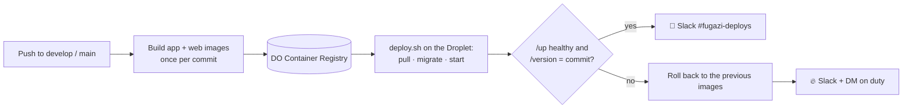

# Hosted setup: staging and production on DigitalOcean

Two Droplets, one per environment. Each one runs the same Docker stack (`deploy/compose.yml`): nginx with Let's Encrypt HTTPS, php-fpm, a queue worker, the scheduler, MySQL and certbot. GitHub Actions builds the images once, pushes them to DigitalOcean Container Registry and deploys them over SSH. Nothing is built on the servers.

| Push to   | Deploys to | Who can push                                            |
| --------- | ---------- | ------------------------------------------------------- |
| `develop` | staging    | the Merge Gate, or a developer merging a PR             |
| `main`    | production | the Deploy Gate (release PR), or a developer merging it |



**Production ships what staging ran.** When the Deploy Gate merges the release PR, the merge commit has the same files as develop's head, so the Deploy workflow reuses that commit's images instead of building new ones.

**Automatic rollback.** `deploy/deploy.sh` keeps the previous release's images and settings on the server. If the new release doesn't answer `/up` and report its own commit on `/version` within 90 seconds, it switches back and the workflow fails. Migrations are not rolled back, so write them to be backwards compatible: add first, remove in a later release.

## What it costs

About $29 a month: two 2 GB Droplets ($12 each) and a Basic registry ($5). Droplet backups for production add 20% of that Droplet's price.

## 1. DigitalOcean (you, in the control panel)

1. **API token:** API → Tokens → Generate New Token, name `fugazi-github-actions`, 1 year, **custom scopes: `registry` (create, read, update, delete)**. Nothing else; the workflow only talks to the registry.
   Save it as a repository secret:

    ```bash
    gh secret set DIGITALOCEAN_ACCESS_TOKEN --repo fugazibyus/FugaziByUs
    ```

2. **Container Registry:** Container Registry → Create, name `fugazibyus` (any name works), plan **Basic** ($5, 5 repositories). The images go in two repositories, `app` and `web`. Then:

    ```bash
    gh variable set DOCR_REGISTRY --repo fugazibyus/FugaziByUs --body fugazibyus
    ```

3. **Two Droplets:** Create → Droplets, twice:
    - Ubuntu 24.04 LTS, Basic, Regular, **2 GB / 1 CPU**, the region closest to your users (Sydney: `syd1`).
    - Authentication: your own SSH key.
    - Names: `fugazi-staging` and `fugazi-production`. Turn on **Backups** for production.

4. **Cloud Firewall** (Networking → Firewalls), applied to both Droplets: inbound SSH 22, HTTP 80 and HTTPS 443 from anywhere. GitHub's hosted runners have no fixed IP range, so SSH relies on keys: passwords are off and only two keys are allowed (yours for root, the deploy key for `deploy`).

## 2. Secrets (Claude runs this; nothing is printed)

```bash
scripts/deploy-secrets.sh
```

It creates `APP_KEY` and `DB_PASSWORD` in the `staging` and `production` environments, plus an SSH key pair for deploys: the private half in the `DEPLOY_SSH_KEY` secret and the public half in the `DEPLOY_SSH_PUBLIC_KEY` variable. It never replaces values that already exist.

## 3. Prepare each Droplet (about 3 minutes each)

```bash
scp scripts/droplet-init.sh root@<ip>:
```

```bash
ssh root@<ip> "bash droplet-init.sh '$(gh variable get DEPLOY_SSH_PUBLIC_KEY --repo fugazibyus/FugaziByUs)'"
```

It installs security updates and Docker, adds a swap file, creates the `deploy` user, turns off SSH passwords, opens only 22/80/443 and schedules a nightly database dump. It is safe to run again. The last line it prints is the server's SSH host key, which GitHub uses to recognise the Droplet.

## 4. Point each environment at its Droplet

For `staging` and again for `production`, with that Droplet's IP:

```bash
gh variable set DEPLOY_HOST --env staging --repo fugazibyus/FugaziByUs --body <ip>
```

```bash
ssh-keyscan -t ed25519 <ip> | gh variable set DEPLOY_KNOWN_HOSTS --env staging --repo fugazibyus/FugaziByUs
```

Check that the key `ssh-keyscan` returns matches the last line `droplet-init.sh` printed.

Then tell the Deploy Gate where staging is, so it can check that staging runs the release commit:

```bash
gh variable set STAGING_URL --repo fugazibyus/FugaziByUs --body https://staging.<staging-ip-with-dashes>.sslip.io
```

### Hostnames

Without a domain, each environment gets a free [sslip.io](https://sslip.io) hostname from its IP, with a real Let's Encrypt certificate:

- staging: `https://staging.164-90-12-34.sslip.io`
- production: `https://170-64-1-2.sslip.io`

To use a real domain later, point its DNS A record at the Droplet, set the `APP_DOMAIN` variable on that environment and redeploy. The certificate is issued on that deploy.

Optional repository variable: `LETSENCRYPT_EMAIL`, where Let's Encrypt sends expiry warnings (renewal is automatic, so these should never come).

## 5. Production deploys without a click

The `production` environment currently requires a review from `@devs`, which would pause every production deploy, including the Deploy Gate's. The gate already decides what reaches `main` (business hours, staging soak, every PR checked, no unapproved migrations), and only the gate or a developer can merge into `main`. So remove the required reviewers and keep the `main`-only branch rule:

**Settings → Environments → production → Deployment protection rules:** untick **Required reviewers**. Keep **Deployment branches and tags: `main`**.

To put people back in the loop at any time, set `AI_AUTODEPLOY_PRODUCTION=off` (or use **AI · pause and resume**). The gate then refuses every release and a developer merges it.

## 6. First deploy

Actions → **Deploy** → Run workflow → from `develop`, environment `staging`. The first run builds both images (about 5 minutes), requests the certificate and runs the migrations. Then merge anything into `main` (or run it from `main` with environment `production`).

## Optional: metrics on production

The homepage widget fills from Anthropic webhooks. To turn them on:

1. Create a separate Anthropic API key named `fugazi-web-production`, so it can be revoked without touching the agents' key, and store it as the `APP_ANTHROPIC_API_KEY` secret on the `production` environment.
2. In the Claude Console create a webhook to `https://<production-host>/webhooks/anthropic` for `session.status_*` and store its signing secret as `ANTHROPIC_WEBHOOK_SIGNING_KEY` on the `production` environment.
3. Redeploy production.

Without the key, the server turns off its ten-minute metrics sync (`AI_SYNC_RUNS=false`) and the widget shows what was already stored.

## Running it

| Task                                     | How                                                                                                                      |
| ---------------------------------------- | ------------------------------------------------------------------------------------------------------------------------ |
| Deploy any branch to staging             | Actions → Deploy → Run workflow from `develop`, environment `staging`, ref = the branch                                  |
| Go back to an earlier production release | Actions → Deploy → Run workflow from `main`, environment `production`, ref = that commit                                 |
| Roll back without GitHub (break-glass)   | `ssh root@<ip> sudo -u deploy /opt/fugazi/deploy.sh rollback`: the previous images are on the server, no registry needed |
| What's running                           | `ssh root@<ip> sudo -u deploy /opt/fugazi/deploy.sh status`, or `https://<host>/version`                                 |
| Logs                                     | `ssh root@<ip>` then `cd /opt/fugazi && docker compose logs -f app queue`                                                |
| Restore last night's database dump       | see the header of `deploy/backup.sh`                                                                                     |
| Stop automatic staging deploys           | `gh variable set AI_AUTODEPLOY_STAGING --body off`                                                                       |

## Settings reference

| Where                | Name                                                                | What                                                                         |
| -------------------- | ------------------------------------------------------------------- | ---------------------------------------------------------------------------- |
| Repository secret    | `DIGITALOCEAN_ACCESS_TOKEN`                                         | registry-only token; the workflow turns it into 15–30 minute registry logins |
| Repository secret    | `DEPLOY_SSH_KEY`                                                    | the `deploy` user's private key (from `scripts/deploy-secrets.sh`)           |
| Repository variable  | `DEPLOY_SSH_PUBLIC_KEY`                                             | its public half, for `droplet-init.sh`                                       |
| Repository variable  | `DOCR_REGISTRY`                                                     | registry name; until it exists the Deploy workflow does nothing              |
| Repository variable  | `STAGING_URL`                                                       | the Deploy Gate checks staging's `/up` and `/version` here                   |
| Repository variable  | `LETSENCRYPT_EMAIL` (optional)                                      | certificate expiry warnings                                                  |
| Repository variable  | `AI_AUTODEPLOY_STAGING`                                             | `off` stops automatic staging deploys                                        |
| Environment secret   | `APP_KEY`, `DB_PASSWORD`                                            | per environment, generated                                                   |
| Environment variable | `DEPLOY_HOST`                                                       | the Droplet's IP                                                             |
| Environment variable | `DEPLOY_KNOWN_HOSTS`                                                | the Droplet's SSH host key (`ssh-keyscan` line)                              |
| Environment variable | `APP_DOMAIN` (optional)                                             | a real domain; empty = the sslip.io hostname                                 |
| Environment secrets  | `APP_ANTHROPIC_API_KEY`, `ANTHROPIC_WEBHOOK_SIGNING_KEY` (optional) | production metrics, see above                                                |

Production also gets the repository's `SLACK_BOT_TOKEN`, so contact-form messages reach `#fugazi-contact`. Staging doesn't, so testing the form there never posts to the real channel.
